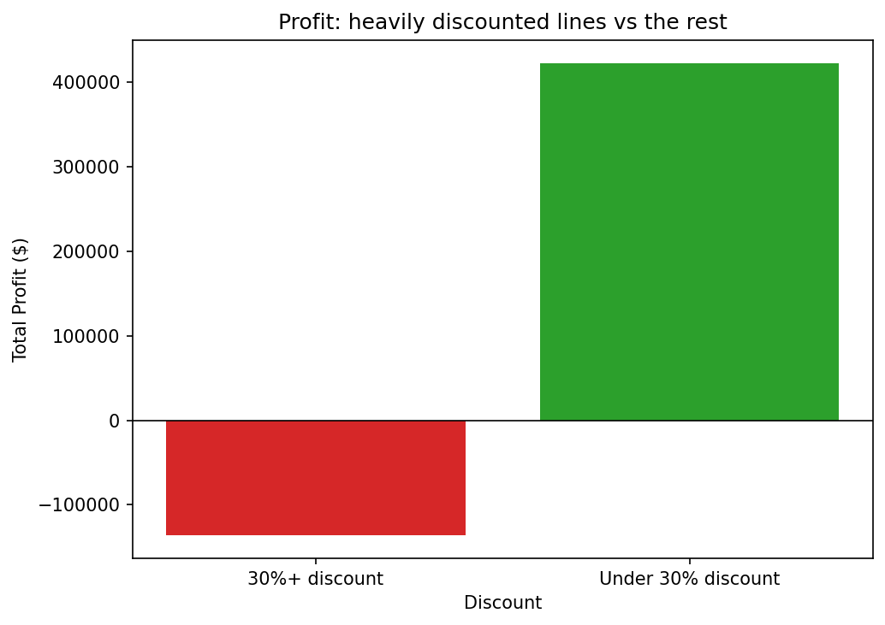
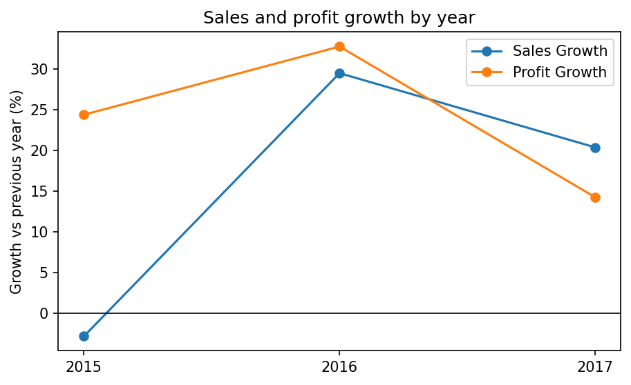
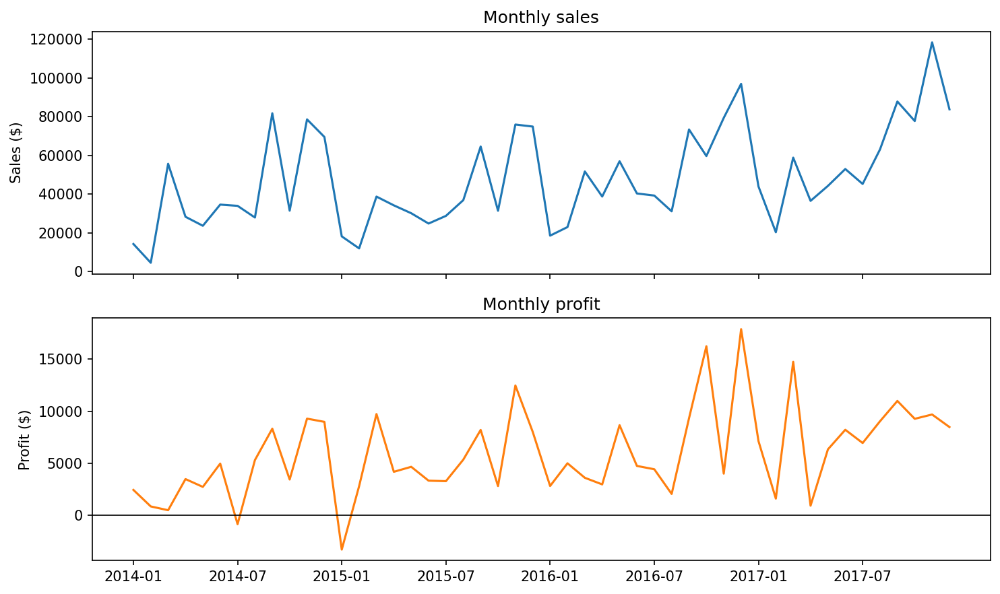
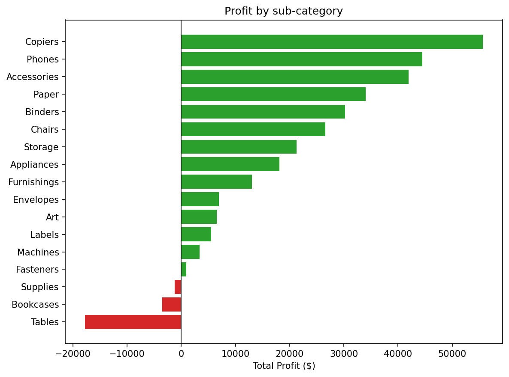
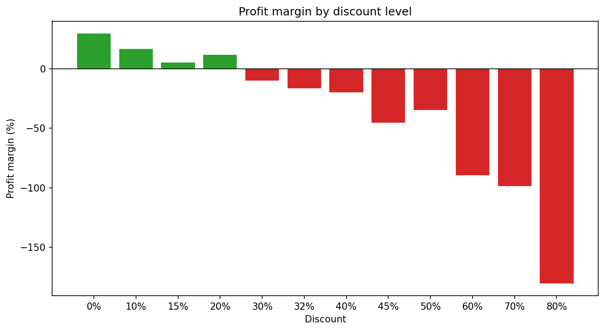
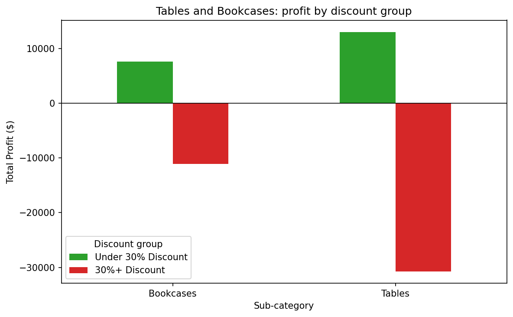
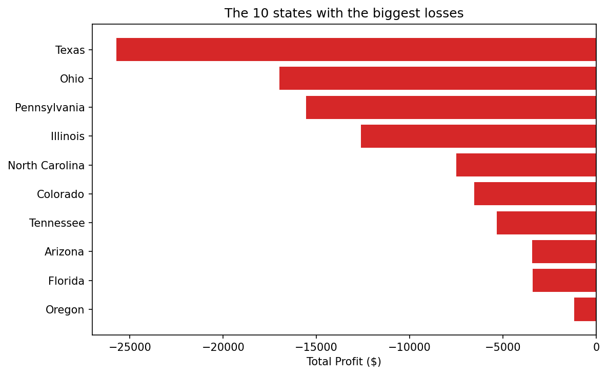
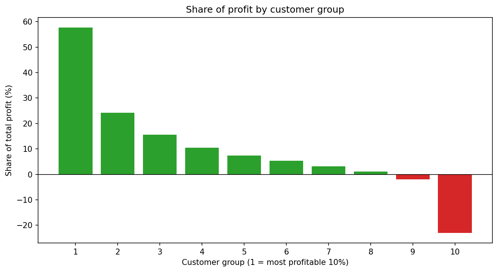

# Superstore Sales Analysis

**Business question:** where do strong sales fail to become profit?

An analysis of four years of retail orders using SQL Server and Python. The SQL answers the business questions, and Python turns the results into charts.

**Author:** Sherif Essam | [LinkedIn](https://www.linkedin.com/in/sherif-essam-8b07ba443)

## Key finding

Order lines discounted 30% or more are only 13.9% of all lines, but they lost about $135k. That equals 47% of the profit the whole business recorded ($286k). Every other line earned about $422k.



This is an association. It does not prove that discounts cause the losses.

## Tools

- **SQL Server (SSMS):** data checks and all analysis queries
- **Python (pandas, matplotlib) in Google Colab:** charts
- **SQL techniques used:** `GROUP BY`, `HAVING`, `CASE`, subqueries, CTEs, and window functions (`LAG`, `RANK`, `ROW_NUMBER`, `NTILE`, running total, moving average)

## Data

- Source: [Superstore dataset on Kaggle](https://www.kaggle.com/datasets/vivek468/superstore-dataset-final)
- 9,994 order lines, 5,009 orders, 793 customers
- Orders from 3 January 2014 to 30 December 2017
- Each row is one product on one order. `Sales` is revenue after discount.

The raw file is not included in this repository. See `data/README.md` for the download link.

## Findings

### 1. Did profit grow as fast as sales?



Profit grew faster than sales in 2015 and 2016. In 2017 sales grew 20.4% while profit grew only 14.2%, so margin slipped.

### 2. Does profit follow the sales peaks?



Sales peak at the end of each year, and November and December make up 29.5% of all sales. Profit does not follow. The highest sales month (November 2017, about $118k) earned only about $9.7k profit, a margin of 8.2%.

### 3. Which sub-categories lose money?



Three sub-categories lose money: Tables (-$17.7k), Bookcases (-$3.5k) and Supplies (-$1.2k). Tables rank 4th in sales but last in profit.

### 4. At what discount does profit turn negative?



Margin is positive up to a 20% discount (29.5% with no discount, 11.8% at 20%). It turns negative at 30% (-10.1%) and falls to -180% at 80%. Some levels have few lines (for example 11 lines at 45%), so they should not be over-read.

### 5. How much profit is lost on heavily discounted lines?

Lines discounted 30% or more are 13.9% of order lines and 15.8% of sales, but lost about $135k (-37.3% margin). All other lines earned about $422k (21.8% margin). The chart is shown under "Key finding".

### 6. Do Tables and Bookcases lose money only at heavy discounts?



Both sub-categories make money under a 30% discount (Tables +$13.0k, Bookcases +$7.6k) but lose heavily at 30% or more (Tables -$30.7k, Bookcases -$11.1k). Comparing within the same product type points to discounting as the likelier driver of the losses, though it does not prove it.

### 7. Which states lose the most money?



Ten states lose money, about $98.2k combined. Texas (-$25.7k), Ohio (-$17.0k), Pennsylvania (-$15.6k) and Illinois (-$12.6k) lose about $70.9k together.

### 8. How concentrated is profit across customers?



The top 10% of customers (80 of 793) earn 57.7% of total profit, and the top 20% earn about 82%. The bottom two groups lose about $71k combined.

### Other results from the SQL

- **Categories:** Furniture is 32.3% of sales but only 6.4% of profit (2.5% margin). Technology is 36.4% of sales and 50.8% of profit.
- **Regions:** no region loses money overall, but Central earns a 7.9% margin against 14.9% in the West.
- **Shipping mode:** margins are similar (12.1% to 13.9%). The data has no shipping cost, so shipping profitability cannot be measured fully.
- **Products:** the Canon imageCLASS 2200 copier earns about $25.2k and is the top profit earner in three of the four regions.

## Recommendations

1. **Review how discounts of 30% or more are approved.** Find out why each was given (clearance, sales rep choice, bundles).
2. **Start with Tables and Bookcases** and with the four states that lose the most: Texas, Ohio, Pennsylvania and Illinois.
3. **Look at Supplies separately.** It has no heavy discounts, yet it loses $2.9k at a normal 20% discount (73 lines). The whole loss comes from letter openers, which earn only about a 3% margin at full price and fall to -21% at a 20% discount. Other Supplies products stay profitable at 20%.
4. **Run a controlled test before changing policy.** For example, cap discounts in one region and compare profit with a similar region. This analysis cannot say how many sales would be lost without the discounts.

## Data quality and limits

- Checked before analysis: 9,994 rows, no duplicate row IDs, no missing values in the key columns, and no impossible values (negative sales, zero quantity, discount outside 0 to 1, or ship date before order date).
- Negative profit was kept, because a loss is real business information.
- One pair of order lines is identical except for the row ID (rows 3406 and 3407). It was kept, because the data cannot show whether it is an error, and it changes total profit by only about $12.
- 438 order lines have a postal code missing its leading zero in the source file (for example 6824 for 06824). Postal code is not used in the analysis.
- This is sample data, and profit is as recorded, with no cost detail.
- The findings are associations. There is no test or control group, so they do not prove cause.

## Project structure

```
├── README.md
├── data/
│   └── README.md                     link to the Kaggle dataset
├── sql/
│   ├── 01_setup_cleaning.sql         data quality checks
│   ├── 02_analysis_queries.sql       14 business questions
│   └── 03_advanced_queries.sql       CTEs, window functions and follow-up checks
├── notebooks/
│   └── exploratory_analysis.ipynb    charts and findings
└── reports/
    ├── tables/                       query results as CSV
    └── figures/                      chart images
```

## How to run it

1. Download `Sample - Superstore.csv` from the Kaggle link.
2. In SSMS, import it with the Import Flat File wizard as a table named `Sample - Superstore`.
3. Run the files in `sql/` in order: 01, 02, 03.
4. Open `notebooks/exploratory_analysis.ipynb` in Google Colab, upload the CSVs from `reports/tables/`, and choose Runtime, then Run all.
